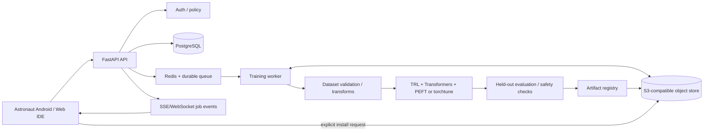
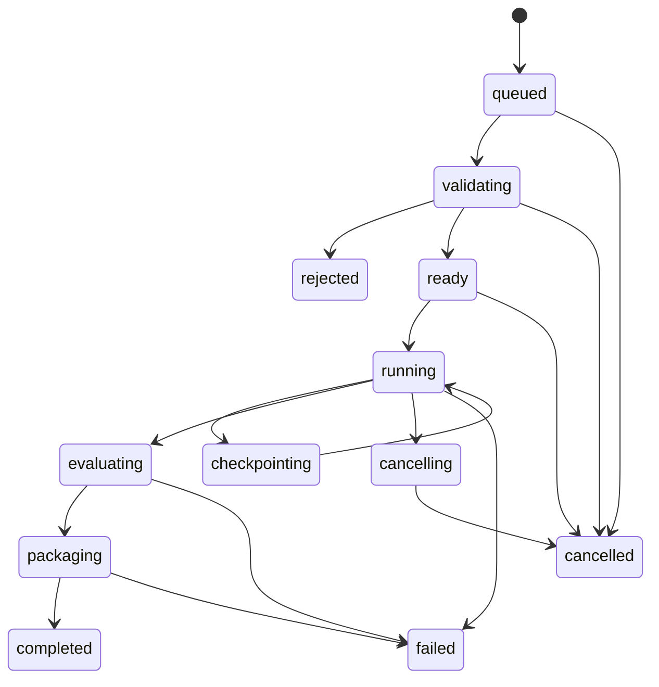

# Astronaut — Backend Developer and AI Training Architecture

## Core decision

Separate the optional backend into a control plane and isolated execution workers. The Android client remains offline-capable. The backend is for remote development and compute-intensive training, not a mandatory dependency for chat.

## Backend components

- API: FastAPI, versioned REST endpoints and WebSocket/SSE event stream.
- Identity: optional self-hosted account/token auth for remote use; local-only deployment can bind to loopback/LAN and disable public ingress.
- Metadata: PostgreSQL for projects, datasets, training jobs, model versions, evaluations and audit events.
- Queue: Redis-backed durable worker queue (Celery or equivalent) for long-running jobs; FastAPI BackgroundTasks only for short non-critical tasks.
- Artifact store: S3-compatible object storage with private buckets, checksums, lifecycle and signed short-lived download URLs.
- Workers: isolated GPU worker images, one job per allocation by default, explicit GPU/memory/time quotas.
- Observability: structured logs, job events, metrics, worker health and redaction of secrets and dataset contents.

## Service topology



## Training pipeline

1. Dataset registration: create immutable dataset version with source, license, checksum, schema and owner.
2. Ingestion: accept JSONL/JSON/CSV or supported conversation formats; enforce size/type limits; scan archives; reject path traversal and unsafe content.
3. Preview: show examples, counts, token-length distribution and schema errors before training.
4. Privacy: redact configured secrets/PII; user confirms remote upload and retention. Never train on chats by default.
5. Quality: deduplicate, detect malformed samples, check train/validation contamination and create deterministic splits.
6. Recipe selection: start with supervised fine-tuning (SFT) using LoRA. Add QLoRA only for compatible model/hardware combinations. Add DPO only after preference-pair data validation.
7. Preflight: verify model license, model architecture support, tokenizer, GPU VRAM, disk, sequence length and package versions.
8. Execution: immutable config and image digest; checkpoint to durable storage; emit progress from actual worker events; support cancellation and resume only where recipe supports it.
9. Evaluation: compare base and tuned model on held-out task metrics and regression/safety tests. A completed training run is not automatically a good model.
10. Packaging: save adapter separately, record base model revision, tokenizer, prompt template, training data version, hyperparameters, evaluation report, license and SHA-256.
11. Promotion: require explicit user approval before model registry marks artifact installable.
12. Distribution: client downloads with resumable transfer, verifies checksum/signature and confirms runtime compatibility before installation.

## Initial training stack

- PyTorch + Transformers for model loading/training.
- TRL SFTTrainer for supervised fine-tuning.
- PEFT LoRA adapters for parameter-efficient updates.
- torchtune as an alternative recipe-driven training stack where model support is a better fit.
- Safetensors for appropriate tensor artifacts; preserve original model formats only through explicit supported conversion paths.

Do not promise one universal training recipe for every model family. Maintain a compatibility matrix by model architecture, tokenizer, attention implementation, quantization mode, trainer version and GPU type.

## Suggested backend repository

```text
backend/
  pyproject.toml
  Dockerfile.api
  Dockerfile.worker
  docker-compose.yml
  alembic/
  app/
    main.py
    api/v1/
      health.py
      projects.py
      datasets.py
      training_jobs.py
      models.py
      artifacts.py
    core/
      config.py
      auth.py
      policy.py
      events.py
    db/
      models.py
      session.py
      repositories/
    schemas/
    services/
      dataset_service.py
      training_service.py
      artifact_service.py
    workers/
      celery_app.py
      tasks.py
    training/
      base.py
      recipes/
        sft_lora.py
        sft_qlora.py
      evaluation/
      packaging/
    storage/
    tests/
      unit/
      integration/
      security/
  configs/
    recipes/
```

## API contract (initial)

- POST /api/v1/datasets — register dataset metadata.
- POST /api/v1/datasets/{id}/uploads — initiate upload and receive scoped upload instructions.
- POST /api/v1/datasets/{id}/validate — queue validation; return validation job ID.
- GET /api/v1/datasets/{id}/preview — retrieve redacted sample preview and statistics.
- POST /api/v1/training-jobs — submit immutable training config; return 202 and job ID.
- GET /api/v1/training-jobs/{id} — retrieve authoritative state.
- GET /api/v1/training-jobs/{id}/events — stream real state/progress events.
- POST /api/v1/training-jobs/{id}/cancel — request cancellation.
- GET /api/v1/models — list promoted artifacts and compatibility metadata.
- GET /api/v1/models/{id}/manifest — retrieve signed artifact manifest.
- POST /api/v1/projects — create remote development project.
- GET /api/v1/health — health and version; no secrets.

All endpoints require authorization when exposed beyond loopback. Validate ownership on every object. Use idempotency keys for job submission and upload initialization.

## Job state machine



Progress is not a guessed percentage. Report named phases and actual step/epoch counters from the worker. If a worker dies, mark the job interrupted and recover only from a valid checkpoint.

## Security and privacy controls

- Private object storage; short-lived scoped upload/download URLs.
- TLS for network access; no public unauthenticated training API.
- Per-user/project authorization and audit trail.
- Worker containers without host Docker socket; read-only base image; isolated scratch volume; no arbitrary outbound network by default.
- Archive bomb, decompression, file size and parser limits.
- Secret/PII scanning and user-reviewed redaction.
- Dataset retention/deletion policy and explicit consent.
- Artifact checksum plus signed manifest; verify on Android before install.
- Never log prompts, dataset rows, tokens or credentials by default.

## Hardware reality

The Moto G54 is a client and local inference target, not a realistic general-purpose LLM fine-tuning server. Start with an optional Linux GPU host. Provide a local CPU-only tiny-model training experiment only as an explicitly limited developer feature, not the default path. Training hardware requirements must be computed from the selected model, sequence length, batch, precision, optimizer and quantization recipe, then validated by worker preflight.

## References

- FastAPI background tasks and heavy-work caveat: https://fastapi.tiangolo.com/tutorial/background-tasks/
- Hugging Face PEFT LoRA: https://huggingface.co/docs/peft/main/package_reference/lora
- TRL PEFT integration: https://huggingface.co/docs/trl/main/en/peft_integration
- torchtune recipes: https://meta-pytorch.org/torchtune/stable/recipes/recipes_overview.html
