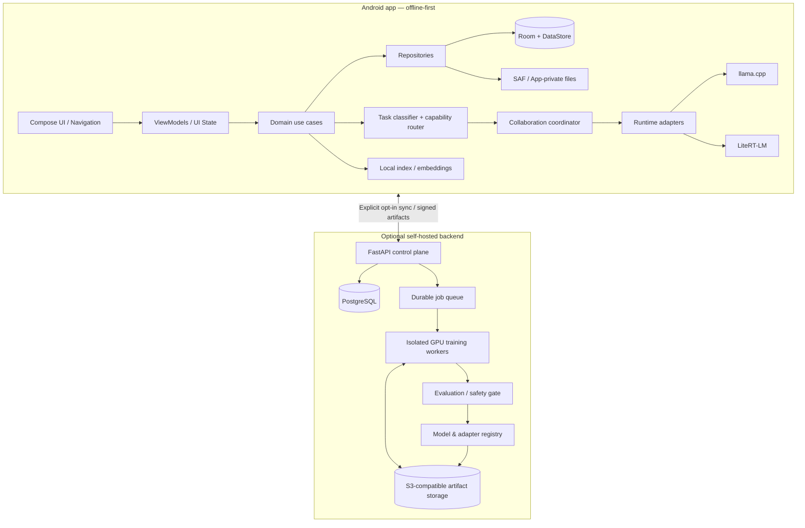

# Astronaut — Product and Technical Architecture

## Product boundary

Astronaut is an offline-first Android AI messenger with two optional companion systems:
1. Backend Developer Studio: local project/code/API workspace.
2. AI Training Studio: dataset preparation and training-job management.

The Android app must remain useful with airplane mode enabled after models and resources are installed. Remote backend features are explicitly optional and must never be silently used for chat or upload private data.

## System topology

## Android dependency direction

Presentation -> domain -> repository interfaces. Data implementations provide Room, DataStore, filesystem and optional network sources. Runtime adapters implement provider contracts and must not leak runtime-specific classes into UI or domain modules.

Recommended Gradle modules:
- :app
- :core:common
- :core:database
- :core:datastore
- :core:designsystem
- :core:files
- :core:security
- :core:testing
- :feature:chats
- :feature:aihub
- :feature:modellibrary
- :feature:workspace
- :feature:backendstudio
- :feature:trainingstudio
- :feature:activity
- :feature:settings
- :domain:chat
- :domain:orchestration
- :domain:models
- :runtime:api
- :runtime:llamacpp
- :runtime:litert
- :data:chat
- :data:catalog
- :data:workspace

Do not create all modules as empty shells in one commit. Extract modules when their interfaces and tests are ready; begin with a small compilable vertical slice.

## Chat request lifecycle

1. Persist the user's message and a generation record.
2. Resolve conversation context and attachment extraction results.
3. Classify intent and required capabilities.
4. Query installed model metadata and runtime health.
5. Apply RAM budget, context budget, thermal state and user overrides.
6. Require two distinct compatible model identities for full collaboration.
7. Run participant A, unload if needed, then participant B.
8. Run cross-review with explicit references to participant outputs.
9. Verify conflicts and evidence; coordinator synthesizes.
10. Persist final answer, participant statuses, timings and unresolved disagreements.
11. If two participants or a coordinator are unavailable, return an explicit collaboration-unavailable status. Never label single-model output as collaboration.

## Data ownership

Room is the source of truth for conversations, messages, generation events, attachments metadata, projects, tasks and local model records. Files themselves live in app-private storage or user-selected SAF locations. Persist URI grants only when the user chooses to retain an attachment. Keep extracted text and indexes separately from original files so users can delete each intentionally.

## Model/runtime abstraction

A model catalog entry describes artifact format, architecture, tokenizer/template, runtime compatibility, capabilities, context limit, quantization, license, provenance, checksum and resource estimate. Runtime adapters advertise supported artifact formats and operations. Never infer support solely from a model family name or file extension.

llama.cpp is the first GGUF runtime candidate. LiteRT-LM is a separate adapter for models and artifacts supported by that runtime. Runtime capability probes and smoke tests must determine availability on the device.

## Mobile resource policy

- One heavyweight model loaded at a time by default.
- Sequential participant execution with unload and memory-pressure handling.
- Configurable context and generation limits.
- Reserve memory for Android, Compose, media and database.
- Abort or defer inference on critical thermal/memory conditions.
- Model download/indexing via WorkManager; foreground execution only when user-visible and justified.
- No promise of running large model training on the Moto G54.

## Privacy and trust

No mandatory account, telemetry or cloud inference. Backend connections are opt-in, endpoint-visible and revocable. Dataset upload requires a separate confirmation showing selected files, destination and retention policy. Store tokens in Android Keystore-backed encrypted storage. Training workers use isolated job directories, least-privilege credentials, resource limits and artifact scanning.

## Architectural references

- Android architecture recommendations: https://developer.android.com/topic/architecture/recommendations
- llama.cpp Android: https://github.com/ggml-org/llama.cpp/blob/master/docs/android.md
- FastAPI background tasks: https://fastapi.tiangolo.com/tutorial/background-tasks/
- Hugging Face PEFT LoRA: https://huggingface.co/docs/peft/main/package_reference/lora
- PyTorch torchtune recipes: https://meta-pytorch.org/torchtune/stable/recipes/recipes_overview.html
